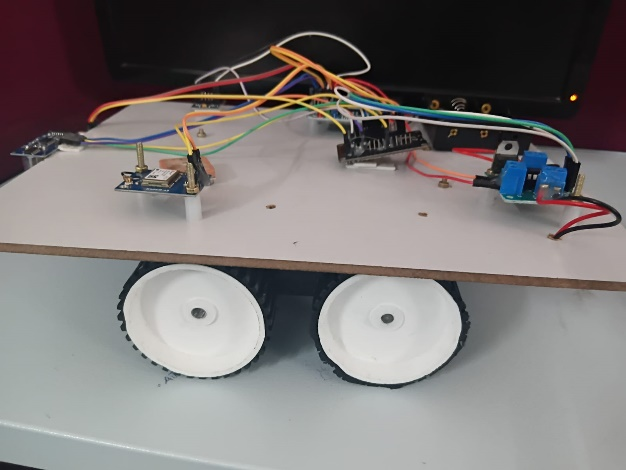

# IoT Platform for Road Surface Analysis using MEMS Data

ESP32-based prototype that detects potholes, humps and rough road patches using an ADXL345 MEMS accelerometer and ultrasonic sensing. It tags defects with GPS coordinates and streams everything to an Arduino IoT Cloud dashboard. A small robot platform can be driven from the dashboard and stops automatically at obstacles.

Final-year project, B.E. ECE, M.A.M College of Engineering and Technology (Anna University), 2026.



## Features
- Vibration magnitude from ADXL345 (±16 g)
- Road-facing ultrasonic sensor for pothole / hump detection
- Road Surface Index (RSI 0-100) and GOOD / MODERATE / BAD status
- NEO-6M GPS location sent to a cloud map widget
- Obstacle detection with automatic motor stop
- Remote drive commands from the Arduino IoT Cloud dashboard

## Repository layout
```
.
├── firmware/road_surface_analyzer/
│   ├── road_surface_analyzer.ino   # main sketch
│   ├── config.h                    # pins and thresholds
│   ├── motors.h                    # motor driver helpers
│   └── secrets.example.h           # copy to secrets.h (git-ignored)
├── hardware/
│   └── pin-mapping.md              # wiring, RSI table, commands
└── docs/
    ├── Project_Report.docx         # full original report
    ├── 01-abstract.md ... 10-references.md
    └── images/                     # block/circuit diagrams, results
```

## Hardware
ESP32 DevKit, ADXL345, 2x HC-SR04, NEO-6M GPS, L293D/L298N + 2 DC motors, 16x2 LCD, regulated power supply.

## Getting started
1. Install Arduino IDE and the ESP32 board package.
2. Install libraries: `Adafruit ADXL345`, `Adafruit Unified Sensor`, `TinyGPSPlus`, `LiquidCrystal`, `ArduinoIoTCloud`, `Arduino_ConnectionHandler`.
3. In `firmware/road_surface_analyzer/`, copy `secrets.example.h` to `secrets.h` and fill in your Wi-Fi and Arduino Cloud device credentials.
4. Create an Arduino Cloud Thing with these variables: `aDXL_Ultra` (String), `roadStatus` (String), `rsivalue` (float), `mapi` (Location), `robot` (String), `obstatus` (String).
5. Select your ESP32 board and port, then upload.

## Documentation
See [`docs/`](docs/) for the chapter-wise report. Start with the [abstract](docs/01-abstract.md) and [architecture](docs/05-architecture-and-methodology.md).

## Author
Suriya Chakravarthy R: B.E. ECE, M.A.M College of Engineering and Technology
