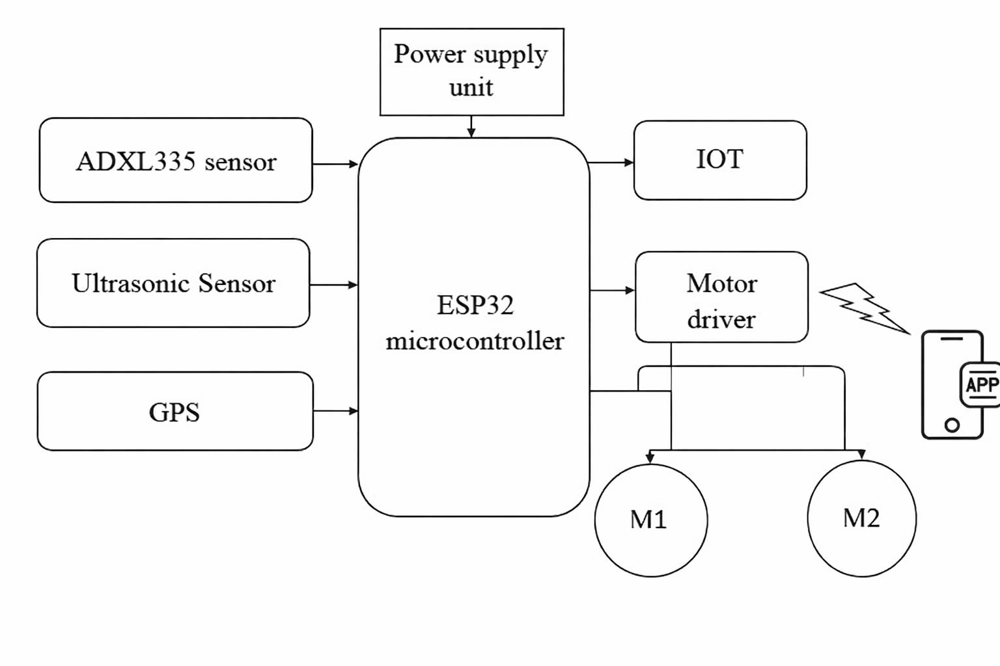
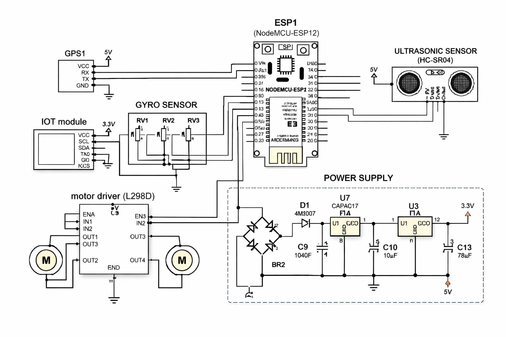

# Architecture, Circuit & Methodology

**4. 3 DESCRIPTION **

The presented block diagram illustrates the overall architecture of the IoT-based Road Surface Analysis and Fault Detection System developed using an ESP32 microcontroller as the central control unit. The system integrates sensing modules, processing components, communication interfaces, and output devices to enable real-time road condition monitoring and intelligent decision-making. Each block plays a specific functional role in ensuring accurate detection, data transmission, and system response.

At the center of the architecture is the ESP32 microcontroller, which serves as the primary processing and communication unit. The ESP32 is selected due to its high computational capability, built-in Wi-Fi module, multiple analog-to-digital converter channels, and energy-efficient operation. It collects input signals from connected sensors, performs signal processing and decision-making tasks, and controls output peripherals. The microcontroller acts as the bridge between sensing, analysis, and cloud communication layers.

The Power Supply Unit provides regulated DC voltage to all components of the system. Since sensors and the microcontroller require stable voltage levels for accurate operation, the power supply ensures proper voltage conversion and filtering. It protects the circuit from fluctuations and maintains consistent performance during vehicle movement.

On the input side, three primary sensors are interfaced with the ESP32. The ADXL335 sensor is a three-axis MEMS accelerometer used to measure vibration, tilt, and acceleration along X, Y, and Z axes. When the vehicle moves over damaged road surfaces such as potholes or cracks, sudden variations in acceleration occur. These variations are captured as analog signals and transmitted to the ESP32 for analysis. The accelerometer plays a critical role in identifying abnormal vibration patterns associated with road defects.

The Ultrasonic Sensor is integrated to measure the distance between the sensor module and the road surface. It operates by transmitting ultrasonic waves and calculating the time required for the echo to return. Any sudden depression or uneven patch on the road surface results in measurable distance variation. This sensor enhances detection accuracy by validating surface irregularities detected through vibration analysis.

The GPS module provides real-time geographical coordinates including latitude and longitude. Whenever a road defect is identified, the system tags the corresponding location data. This enables precise mapping of damaged road segments and facilitates efficient maintenance planning. The integration of GPS ensures spatial accuracy in reporting and monitoring.

On the output side.

The IoT communication module utilizes the built-in Wi-Fi capability of the ESP32 to transmit processed data to a cloud server. Sensor data, defect classification results, and GPS coordinates are uploaded to the cloud platform for storage and analysis. A mobile application accesses this data wirelessly, allowing authorities to monitor road conditions in real time. The application displays defect locations, severity levels, and time stamps on a digital interface.

Additionally, a Motor Driver module is connected to the ESP32 to control two DC motors labeled M1 and M2. This setup represents vehicle movement control in a prototype model. The microcontroller can adjust motor speed or trigger alerts when severe road damage is detected.

Overall, the block diagram demonstrates a comprehensive IoT-based system that integrates sensing, processing, communication, and response mechanisms for automated road surface monitoring and intelligent infrastructure management.

**4. 4 CIRCUIT DIAGRAM **

**4. 5 DESCRIPTION **

The given circuit diagram represents the complete hardware implementation of the IoT-based Road Surface Monitoring System using an ESP32 development board as the central controller. The system integrates a GPS module, gyro sensor, ultrasonic sensor, motor driver, and regulated power supply unit. Each component is interfaced with specific ESP32 pins to ensure proper data acquisition, processing, and communication.

At the core of the circuit is the ESP32 module, which performs sensing, control, and IoT communication functions. The ESP32 operates at 3.3V logic level and includes multiple GPIO pins, ADC channels, UART interfaces, and digital I/O pins. The power supply section consists of a bridge rectifier (BR2), filtering capacitors (C10, C11, C12), voltage regulators (such as 7805 and 1117-3.3V), and an indicator LED. The rectifier converts AC to DC, while voltage regulators provide stable 5V and 3.3V outputs required for sensors and the ESP32.

The GPS module (GPS1) is interfaced using UART communication. The TX pin of the GPS module is connected to the RX pin of the ESP32 (commonly GPIO16), and the RX pin of the GPS is connected to the TX pin of the ESP32 (commonly GPIO17). The VCC pin is connected to 3.3V or 5V depending on module specification, and GND is connected to common ground. This configuration allows real-time latitude and longitude data to be transmitted to the microcontroller.

The gyro sensor module is connected to analog input pins of the ESP32. The X, Y, and Z axis outputs are connected to ADC-enabled GPIO pins such as GPIO34, GPIO35, and GPIO32. These pins support analog voltage reading required for vibration and tilt measurement. The sensor VCC is connected to 3.3V, and GND is connected to system ground.

The ultrasonic sensor (HC-SR04 type) is interfaced using two digital GPIO pins. The TRIG pin is connected to a digital output pin (for example GPIO5), and the ECHO pin is connected to a digital input pin (for example GPIO18). The sensor operates at 5V, and proper level shifting may be used to protect the ESP32 from 5V echo signals. This sensor measures distance variations to detect road surface irregularities.

The motor driver IC (such as L293D) controls two DC motors. Input pins IN1 and IN2 are connected to GPIO25 and GPIO26, while IN3 and IN4 are connected to GPIO27 and GPIO14. Enable pins are connected to PWM-capable pins for speed control. Motor outputs are connected to motors M1 and M2.

Overall, the circuit integrates sensing, processing, display, and communication modules through well-defined ESP32 pin configurations to enable efficient road surface monitoring and IoT-based reporting.

**4. 6 METHODOLOGY **

The methodology of the proposed IoT-based Road Surface Analysis and Fault Detection System is structured into systematic stages including data acquisition, signal preprocessing, feature extraction, machine learning-based classification, geolocation mapping, cloud integration, and user interface visualization. Each stage is carefully designed to ensure accurate detection of road defects and efficient reporting for maintenance planning.

The first stage involves hardware setup and sensor deployment. MEMS-based accelerometer and gyro sensors are mounted securely on a vehicle platform to capture vibration and tilt variations during movement. An ultrasonic sensor is positioned to measure vertical distance variations from the road surface. A GPS module is integrated to provide real-time latitude and longitude coordinates. All sensors are interfaced with the ESP32 microcontroller, which acts as the central processing and communication unit. Proper calibration of sensors is performed before data collection to ensure measurement accuracy and reliability.

The second stage focuses on real-time data acquisition. As the vehicle moves across different road segments, the accelerometer records multi-axis acceleration values, while the ultrasonic sensor measures surface distance fluctuations. Simultaneously, the GPS module captures geographical coordinates. The ESP32 continuously samples sensor data at predefined intervals to ensure high-resolution monitoring.

The third stage is signal preprocessing. Raw sensor data often contains noise due to vehicle suspension, speed variation, and environmental disturbances. To eliminate unwanted components, digital filtering techniques such as moving average filters and low-pass filters are applied. Normalization and scaling processes are performed to standardize the dataset. This step ensures that only meaningful vibration and distance variations are used for further analysis.

The fourth stage involves feature extraction. Instead of directly feeding raw signals into the classifier, statistical and frequency-domain features are extracted. These features include mean, standard deviation, peak acceleration, root mean square values, and signal variance. Feature extraction reduces computational complexity and enhances classification performance.

The fifth stage implements machine learning-based fault detection and classification. A supervised learning model is trained using labeled datasets containing normal and defective road conditions. Algorithms such as Support Vector Machine, Random Forest, or Neural Networks can be employed depending on system complexity. The trained model identifies vibration patterns corresponding to potholes, cracks, and uneven surfaces. Performance metrics such as accuracy, precision, recall, and F1-score are evaluated to validate the model.

The sixth stage integrates geolocation mapping. Whenever the system detects an abnormal road condition, the corresponding GPS coordinates are tagged with the defect classification result. This spatial data is formatted and prepared for transmission.

The seventh stage involves IoT-based cloud communication. Using the built-in Wi-Fi module of the ESP32, processed data is transmitted to a cloud server through secure communication protocols. The cloud platform stores, organizes, and visualizes road defect data in a centralized database.

The final stage includes user interface development. A mobile or web-based application retrieves data from the cloud and displays defect locations on digital maps. Severity levels, timestamps, and statistical summaries are presented for decision-making. Automated alerts are generated for critical road damage cases.

Through these sequential stages, the methodology ensures continuous monitoring, intelligent analysis, and real-time reporting, enabling proactive maintenance and improved road safety management

## Figures

*Fig 4.1 – Block diagram*

*Fig 4.2 – Circuit diagram*
