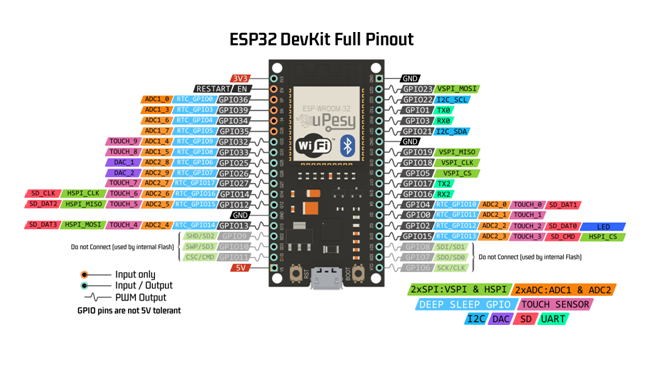
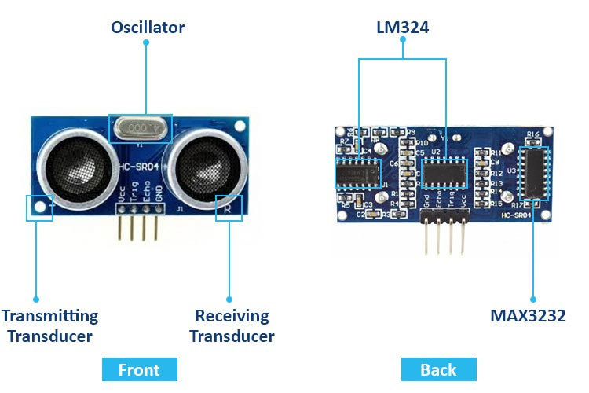
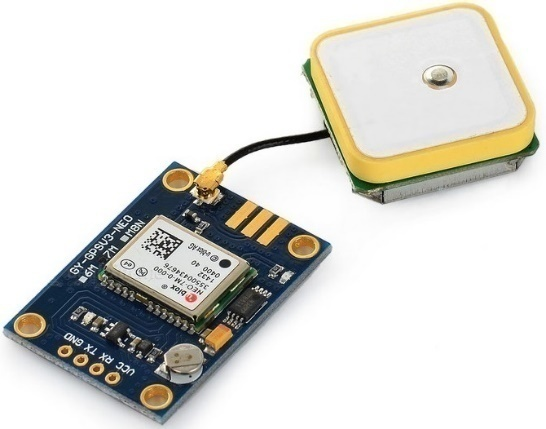
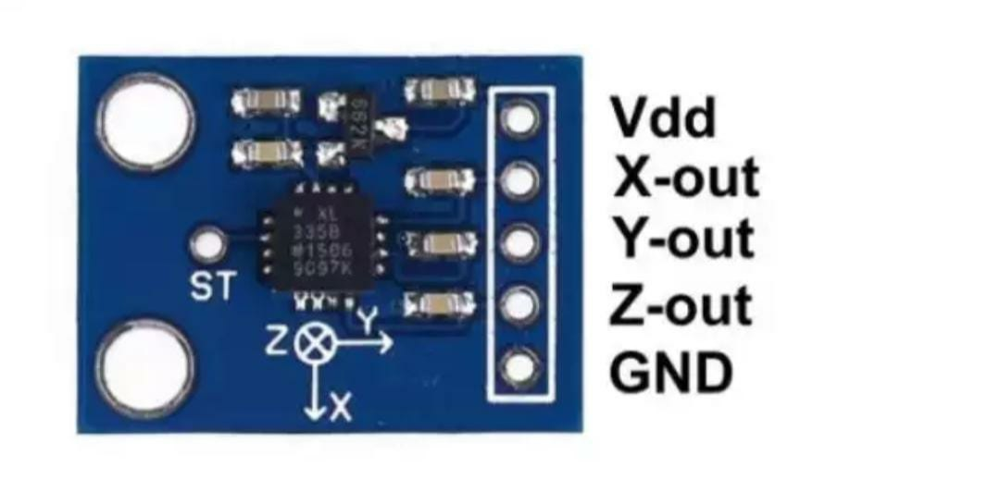
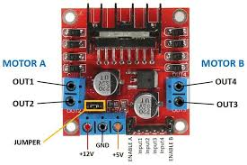

# Hardware Components

**5.1.1 ESP32MICROCONTROLLER**

The ESP32 is an exceptionally versatile and powerful microcontroller designed for a wide range of Internet of Things (IoT) applications. Developed by Espressif Systems, it integrates advanced features, including built-in Wi-Fi and Bluetooth capabilities, which facilitate seamless connectivity to the internet and other devices. At its core, the ESP32 is powered by a dual-core Tensilica LX6 processor, capable of running at speeds up to 240 MHz, enabling it to handle multiple tasks simultaneously. This makes it suitable for complex applications that require significant processing power, such as real-time data analytics and control systems.

With 520 KB of SRAM and the ability to support external SPI flash memory of up to 16 MB, the ESP32 can accommodate extensive programming and data logging requirements. Its rich set of peripherals includes up to 34 programmable GPIO pins, ADC (Analog-to-Digital Converters) with 12-bit resolution, and DAC (Digital-to-Analog Converters) for generating audio signals or other analog outputs. The presence of various communication protocols, such as SPI, I2C, and UART, allows for easy integration with a multitude of sensors and devices, enhancing its applicability across various projects.

Power management is another strength of the ESP32, featuring several power-saving modes that are particularly beneficial for battery-operated devices. These modes allow the microcontroller to enter deep sleep states, significantly reducing power consumption when the device is idle. Furthermore, robust security features, including hardware encryption (AES, SHA-2), secure boot, and flash encryption, ensure secure communication and data integrity, which are essential for many IoT applications where data security is paramount.

The ESP32 is widely supported by various development environments, including the Arduino IDE and Espressif’s own IoT Development Framework (ESP-IDF), which provide extensive libraries and examples to accelerate the development process. Its applications span diverse fields, from smart home devices that automate lighting and security systems to wearable technology for fitness tracking and health monitoring. The microcontroller is also used in environmental monitoring systems that measure temperature, humidity, and air quality, as well as in industrial automation for monitoring equipment performance and controlling automated processes. In the realm of robotics, the ESP32 serves as a central control unit, facilitating wireless communication and sensor integration for complex robotic systems.

In conclusion, the ESP32 stands out as a highly capable and adaptable microcontroller, combining performance, versatility, and extensive connectivity features in a compact package. Its dual-core architecture and comprehensive set of peripherals make it an excellent choice for a wide variety of applications in the ever-expanding field of IoT. Whether for simple hobbyist projects or sophisticated industrial solutions, the ESP32 continues to gain popularity among developers and engineers for its performance, ease of use, and robust feature set, ultimately paving the way for innovative technological advancements in numerous domains.

**ESP32 PIN FUNCTIONS **

- GPIO Pins: Up to 34 configurable General Purpose Input/Output pins for versatile applications. These pins can be programmed for digital input or output, making them suitable for interfacing with a variety of sensors and actuators.

- ADC: Up to 18 channels with 12-bit resolution for accurate analog signal measurement. This feature allows the ESP32 to read varying voltage levels from sensors, providing precise data for applications like environmental monitoring.

- DAC: 2 channels with 8-bit resolution for generating analog outputs. The DAC can be used for audio applications or to control devices that require variable voltage levels.

- Power Pins: V5 for 5V input, V3 for 3.3V output, and multiple GND pins. These power pins facilitate connections to external devices and ensure that the ESP32 operates within its required voltage range.

- I2C Interface: SDA and SCL pins for connecting I2C devices. The I2C protocol allows multiple devices to share the same bus, simplifying the wiring and connections needed for complex projects.

- SPI Interface: Standard pins for MISO, MOSI, SCK, and CS for SPI communication. SPI is a high-speed interface ideal for connecting fast peripherals, such as sensors and memory cards.

- UART Interface: TX and RX pins for serial communication. These pins enable the ESP32 to communicate with other devices over a serial interface, useful for debugging and data transmission.

- Touch Sensor Pins: Configurable pins for touch-sensitive input. This feature allows for the development of user interfaces that can detect touch input, enhancing interactivity in applications.

- RTC Functions: Pins for real-time clock operations and wake-up triggers. These functions are essential for applications requiring time-based operations, even during low power modes.

- Programming/Debugging: EN pin for chip enable and IO0 for boot mode selection during programming. These pins are crucial for loading new firmware and debugging the ESP32 during development.

**ESP32 Specifications **

- Microprocessor: Dual-core Tensilica LX6 processor with up to 240 MHz clock speed. This architecture allows for efficient handling of multiple tasks simultaneously, making it suitable for demanding applications.

- Memory: 520 KB of SRAM and support for up to 16 MB of external SPI flash memory. The ample memory capacity enables the execution of complex algorithms and the storage of extensive data.

- Wireless Connectivity: Integrated Wi-Fi (IEEE 802.11 b/g/n) and Bluetooth (Classic and BLE). This dual connectivity enhances the flexibility of the ESP32 in IoT applications, allowing seamless communication with various devices.

- GPIO Pins: Up to 34 General Purpose Input/Output pins for various applications. These pins can serve multiple functions, such as analog input, PWM output, or digital signaling, making the ESP32 adaptable to different project needs.

- Analog Features: 12-bit ADC with up to 18 channels and 2 channels of 8-bit DAC. The high-resolution analog features are ideal for applications requiring precise signal measurement and generation.

- Power Supply: Operates within a voltage range of 3.0V to 3.6V. This range allows the ESP32 to be powered by various sources, including batteries and regulated power supplies, enhancing its usability in portable applications.

- Power Management: Multiple power-saving modes, including deep sleep. These modes significantly reduce power consumption, making the ESP32 suitable for battery-operated devices and energy-efficient applications.

- Operating Temperature: Functional range from -40°C to 85°C. This wide temperature range ensures reliable performance in diverse environmental conditions, from industrial applications to outdoor deployments.

- Security Features: Hardware encryption (AES, SHA-2), secure boot, and flash encryption. These security measures help protect sensitive data and ensure the integrity of the device, which is critical in IoT applications.

- Development Support: Compatible with Arduino IDE, Espressif ESP-IDF, and other frameworks. The extensive development support, along with a rich set of libraries and resources, simplifies the programming process and accelerates project development.

**5.1.2 ULTRASONIC SENSOR**

The ultrasonic sensor is used to measure the distance between the vehicle and the road surface by transmitting high-frequency sound waves and receiving the reflected echo. It helps in detecting sudden height variations such as potholes, bumps, or uneven surfaces. The sensor calculates distance based on the time taken for the echo to return. This information supports accurate identification of road surface irregularities when combined with vibration data from MEMS sensors. The ultrasonic sensor operates without physical contact and provides reliable measurements under various environmental conditions

**1. WORKING PRINCIPLE OF ULTRASONIC SENSOR**

An ultrasonic sensor works by emitting high-frequency sound waves, typically beyond the range of human hearing, and measuring the time it takes for these waves to travel to an object and bounce back. The sensor consists of a transmitter that sends out an ultrasonic pulse and a receiver that detects the reflected sound waves. When the sensor emits the sound wave, it travels through the air until it encounters an object, which reflects the wave back to the sensor. The sensor measures the time it takes for the sound to travel to the object and return. Using the speed of sound in air, the sensor calculates the distance to the object. The formula used is:

Distance = Speed of Sound×Time

2

The factor of 2 accounts for the round trip of the sound wave. By processing the time and the known speed of sound, the sensor can determine the precise distance between itself and the object. This non-contact measurement method makes ultrasonic sensors valuable in a wide range of applications, such as obstacle detection, distance measurement, and level sensing.

**2. PIN CONFIGURATION OF ULTRASONIC SENSOR **

A common ultrasonic sensor is the HC-SR04. Below is its typical pin configuration:

| VCC | Power supply pin (typically +5V). |
| --- | --- |
| Trig (Trigger): | Sends a 10 µs HIGH pulse to start the ultrasonic wave. |
| Echo | Outputs a HIGH signal with duration proportional to the return time of the wave. |
| GND | Ground pin for the sensor. |

**3. SPECIFICATIONS OF ULTRASONIC SENSORS **

Operating Voltage: 5V DC

Max Current Consumption: ~15 mA during normal operation (up to 50 mA during transmission)

Operating Frequency: 40 kHz

Range: 2 cm to 400 cm (0.02 m to 4 m)

Accuracy: ±3 mm

Resolution: 1 cm (0.01 m)

Beam Angle: About 15 degrees

Response Time: Around 10 ms

Output Type: Digital (Echo pin outputs a HIGH signal, the pulse width corresponds to distance)

**4. APPLICATIONS OF ULTRASONIC SENSORS**

- Robotics: Used in robots for obstacle detection, mapping surroundings, and navigation.

- Automotive: In parking sensors for distance measuring to prevent collisions.

- Industrial Automation: For distance measurement in conveyor belts, material handling, and robotic arms.

- Water Level Measurement: Used in tanks, wells, and reservoirs to monitor water levels.

- Gesture Recognition: Detecting hand or body gestures in interactive systems.

- Medical: Ultrasonic sensors are used in medical devices for measurements and imaging, like in ultrasound imaging.

- Security Systems: For motion detection or perimeter monitoring.

**5.1.3 GPS NEO-6M**

The GPS NEO-6M is a popular GPS (Global Positioning System) module used in various electronics and IoT (Internet of Things) projects. 

**Key Features:**

- **High Sensitivity:** The NEO-6M module is known for its high sensitivity and fast satellite acquisition.

- **Compatibility:** It is compatible with various microcontroller platforms like Arduino, Raspberry Pi, etc.

- **Serial Communication:** Uses UART (Universal Asynchronous Receiver-Transmitter) for communication, making it easy to interface with microcontrollers.

- **Compact Design:** Small and lightweight, suitable for portable applications.

- **Backup Power:** Includes a battery for backup power, maintaining the real-time clock and last position, time, and satellite data.

- **Built-in Antenna**: Some variants come with a built-in ceramic antenna, while others use an external antenna for better signal reception.

**Specifications**:

- VCC: Power supply (3.3V or 5V)

- GND: Ground

- TX: Transmit data (sends data to the microcontroller)

- RX: Receive data (receives data from the microcontroller)

- Voltage: Typically operates at 3.3V or 5V.

- Baud Rate: Default baud rate is 9600.

- Channels: Supports up to 22 tracking/66 acquisition channels.

- Accuracy: Position accuracy of approximately 2.5 meters (CEP).

- Dimensions: Usually around 16 x 12.2 x 2.4 mm for the module itself.

**Applications:**

- **Navigation Systems:** Used in drones, cars, boats, and other navigation systems.

- **Timing Applications:** Provides accurate timing for various applications.

- **Tracking Systems:** Employed in vehicle and asset tracking.

- **Wearable Devices:** Integrated into wearable devices requiring GPS functionality

- **Surveying and Mapping:** Utilized in geographical information systems (GIS) and surveying tools.

**5.1.4 ADXL3 4 5 SENSOR**:

The GY-61 is a breakout board for the ADXL335, a small, low-power, complete 3-axis accelerometer with signal-conditioned voltage outputs. It measures acceleration with a full-scale range of ±3 g and is commonly used in applications requiring tilt sensing, motion detection, and vibration measurement.

**Pin Configuration:**

| VCC | 3.3V or 5V |
| --- | --- |
| GND | Ground |
| XOUT | X-axis acceleration |
| YOUT | Y-axis acceleration |
| ZOUT | Z-axis acceleration |
| Range | ±3 g. |

**Specifications**

- **Operating Voltage: **1.8V to 3.6V for the ADXL335 IC; the GY-61 breakout board typically supports 3.3V to 5V.

- **Measurement Range: ±3 g.**

- **Sensitivity: **Typically 300 mV/g.

- **Bandwidth: **Configurable with external capacitors for each axis (0.5 Hz to 1600 Hz for X and Y axes, and 0.5 Hz to 550 Hz for the Z axis).

- **Current Consumption: **350 μA typical.

- **Using the Sensor **To use the GY-61 (ADXL335) sensor in a project:

- **Power the Sensor: **Connect the VCC pin to the microcontroller's power supply (3.3V or 5V) and GND to ground.

- **Read Analog Values: **Connect XOUT, YOUT, and ZOUT to the analog input pins of the microcontroller.Read the analog values corresponding to each axis.

- **Convert Analog Values: **Convert the analog readings to acceleration values using the sensor's sensitivity (typically 300 mV/g).

- **Implement in Application: **Use the acceleration values in your application for tilt sensing, motion detection, or vibration monitoring.

**Applications**

- **Tilt Sensing: **Used in devices that need to measure tilt or orientation.

- **Motion Detection: **Detects movement and acceleration in various applications.

- **Vibration Monitoring: **Measures vibration in industrial equipment or structures.

- **Gaming and Wearable Devices: **Provides motion input for gaming controls and wearable tech.

- **Robotics: **Used in navigation and balance systems for robots.

- **Automotive Systems:**Measures acceleration for applications like car crash detection and airbag deployment systems

**5.1.5 MOTOR DRIVER **

The motor driver is an essential interface module that enables the ESP32 microcontroller to control DC motors (M1 and M2) safely and efficiently. Since the ESP32 operates at low logic voltage (3.3V) and provides limited current output, it cannot directly drive motors, which typically require higher voltage and current. Therefore, a motor driver IC such as L293D or L298N is used as an intermediate power amplification stage.

Purpose of Motor Driver

The motor driver performs the following functions:

- Amplifies low-power control signals from the ESP32.

- Controls direction of rotation (forward/reverse).

- Regulates motor speed using PWM (Pulse Width Modulation).

- Protects the microcontroller from back EMF generated by motors.

Working Principle

The motor driver operates on the H-bridge principle. An H-bridge circuit allows current to flow in either direction through the motor, enabling bidirectional rotation. By controlling the input logic signals, the direction of motor rotation can be changed.

For example (using L293D):

- IN1 = HIGH, IN2 = LOW → Motor rotates forward

- IN1 = LOW, IN2 = HIGH → Motor rotates reverse

- IN1 = LOW, IN2 = LOW → Motor stops

- IN1 = HIGH, IN2 = HIGH → Motor brakes

PWM signals applied to the Enable (EN) pin allow speed control by varying duty cycle.

Pin Configuration (Typical L293D with ESP32)

Power Pins:

- VCC1 → 5V (Logic supply)

- VCC2 → 6V–12V (Motor supply)

- GND → Common ground with ESP32

Control Pins:

- IN1 → ESP32 GPIO25

- IN2 → ESP32 GPIO26

- IN3 → ESP32 GPIO27

- IN4 → ESP32 GPIO14

- EN1 → PWM pin (e.g., GPIO33)

- EN2 → PWM pin (e.g., GPIO32)

Output Pins:

- OUT1 & OUT2 → Motor M1

- OUT3 & OUT4 → Motor M2

Role in Road Surface Monitoring System

In this project, the motor driver controls the movement of the prototype vehicle. When the system detects severe potholes or obstacles through sensors, the ESP32 can:

- Reduce motor speed.

- Stop the vehicle.

- Trigger alert-based response.

This ensures safe operation and demonstrates automated response capability.

Advantages of Using Motor Driver

- Provides high current driving capability.

- Ensures safe interfacing with microcontroller.

- Enables bidirectional motor control.

- Supports PWM-based speed regulation.

- Protects system from voltage spikes.

Overall, the motor driver acts as a crucial power interface that allows intelligent vehicle movement control in coordination with sensor-based road defect detection.

 **5.2 SOFTWARE REQUIREMENTS **

## Figures

