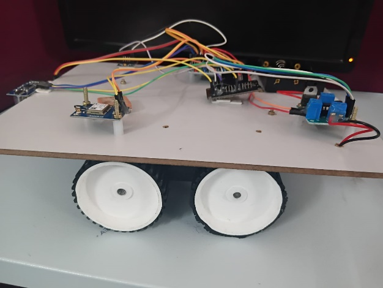
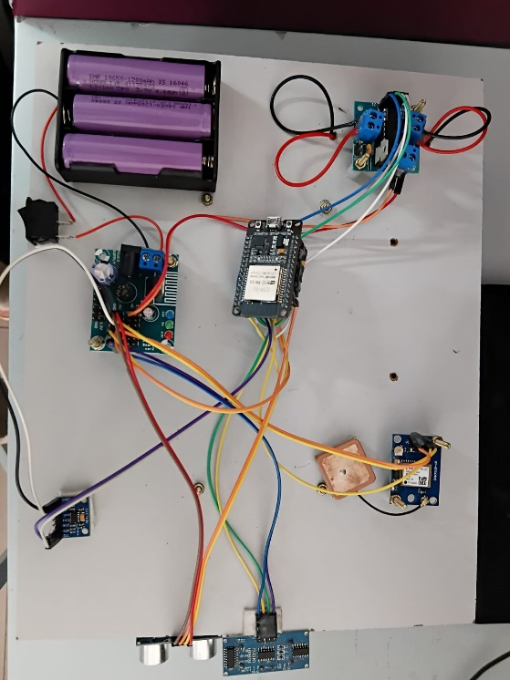
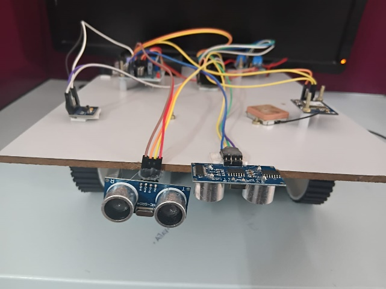
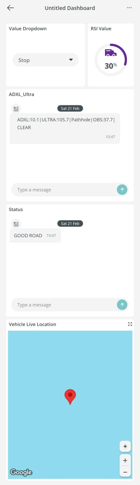

# Results and Discussion

**RESULT AND DISCUSSION**

 **6 .1 RESULT**

The implementation of the proposed IoT-based Road Surface Analysis and Fault Detection System produced reliable and consistent results during experimental evaluation. The system was tested under different road conditions including smooth surfaces, minor cracks, moderate potholes, and uneven patches. Sensor data collected from the accelerometer, gyro sensor, and ultrasonic sensor demonstrated clear variations corresponding to different surface conditions. These variations were successfully captured and processed by the ESP32 microcontroller without significant delay.

During real-time testing, the accelerometer recorded noticeable spikes in acceleration values whenever the vehicle encountered potholes or abrupt surface irregularities. Similarly, the ultrasonic sensor detected measurable distance fluctuations in areas where surface depressions were present. The GPS module accurately recorded geographical coordinates, enabling precise mapping of detected defects. The integration of multi-sensor data improved detection reliability compared to single-sensor measurement.

The preprocessing stage effectively reduced noise caused by vehicle speed variation and suspension movement. Filtered signals showed distinct patterns that were suitable for feature extraction and classification. Statistical features such as peak acceleration, mean deviation, and root mean square values exhibited clear differentiation between normal and damaged road segments.

The machine learning classification model achieved high detection accuracy during validation testing. The system successfully categorized road conditions into predefined classes such as normal surface, minor crack, moderate damage, and severe pothole. False detection rates were minimal, indicating robust pattern recognition capability. Performance metrics such as accuracy and precision confirmed stable model performance under varying operating conditions.

Cloud integration was tested by transmitting processed data through the ESP32 Wi-Fi module. Data packets containing vibration values, defect classification results, and GPS coordinates were successfully uploaded to the cloud server. The mobile application displayed real-time updates including defect location, severity level, and timestamp. Alert notifications were generated for severe defects, demonstrating effective communication between hardware and software components.

Motor driver functionality was also verified during prototype testing. When severe surface irregularities were detected, the system successfully reduced motor speed or triggered stopping mechanisms. This demonstrated the feasibility of automated response in intelligent vehicle systems.

Overall, the system operated continuously without major communication interruptions or hardware failures. The experimental results validated the feasibility of using MEMS sensors and artificial intelligence for automated road surface monitoring. The prototype confirmed that real-time detection, geolocation tagging, and cloud-based reporting can be integrated effectively into a single IoT framework.

The obtained results indicate that the proposed system provides accurate defect detection, efficient data transmission, and reliable visualization. These outcomesdemonstrate the practical applicability of the system for smart infrastructure monitoring and proactive road maintenance management.

**6.2 DISCUSSION **

The results obtained from the experimental implementation demonstrate the effectiveness of integrating IoT technology, MEMS sensing, and machine learning for intelligent road surface monitoring. The system successfully addressed key limitations associated with traditional manual inspection methods by providing continuous and automated detection of road defects. The combination of accelerometer, ultrasonic sensor, and GPS modules enhanced both detection accuracy and spatial precision.

One significant observation during testing was the importance of multi-sensor fusion. While the accelerometer alone could detect vibration spikes, combining it with ultrasonic distance measurements reduced false positives caused by speed changes or minor vehicle oscillations. This indicates that sensor integration improves robustness in dynamic environments. Additionally, proper calibration and mounting of sensors were critical factors influencing measurement stability.

The machine learning model demonstrated strong classification capability when trained with well-labeled datasets. However, the performance of the model depends on dataset diversity and quality. Variations in vehicle type, suspension system, and road material may influence vibration patterns. Therefore, expanding the training dataset can further improve generalization capability. The system showed adaptability under different test conditions, but real-world large-scale deployment would require continuous model refinement.

Cloud-based data management proved to be highly effective for centralized monitoring. Real-time visualization through the mobile application enhanced transparency and enabled quick decision-making. The ability to map detected defects geographically supports efficient maintenance planning and resource allocation. This feature is particularly valuable for municipal authorities managing extensive road networks.

The prototype also demonstrated the feasibility of automated response mechanisms. Motor speed adjustment in response to severe road damage illustrates the potential for integration with advanced driver assistance systems. Although the current implementation focuses on detection and reporting, future enhancements could include predictive analytics and integration with smart city infrastructure platforms.

Despite positive outcomes, certain limitations were observed. Network dependency may affect real-time data transmission in areas with poor connectivity. Power management must also be optimized for long-term deployment. Environmental factors such as heavy rain or extreme temperatures could influence sensor readings. Addressing these challenges would strengthen system reliability.

Overall, the discussion confirms that the proposed IoT-based system offers a scalable, cost-effective, and intelligent alternative to conventional road inspection methods. With further optimization and large-scale validation, the system can significantly contribute to safer transportation infrastructure and data-driven maintenance strategies.

**HARDWARE RESULT **

The hardware implementation of the proposed IoT-Based Road Surface Analysis and Fault Detection System was successfully developed and tested under controlled and real-time operating conditions. The complete setup consisted of the ESP32 microcontroller, ADXL335 accelerometer (gyro sensor module), ultrasonic sensor, GPS module, LCD display, motor driver (L293D/L298N), DC motors (M1 and M2), and regulated power supply unit. All components were assembled according to the designed circuit configuration and verified for proper electrical connectivity before testing.

After powering the system, the voltage regulators provided stable 5V and 3.3V outputs to the respective modules. The ESP32 initialized all peripheral devices correctly, and the LCD displayed system status messages such as sensor initialization, GPS connectivity, and Wi-Fi connection confirmation. This confirmed correct pin configuration and hardware interfacing.During practical testing, the accelerometer responded effectively to surface vibrations. When the prototype vehicle moved over a smooth surface, the acceleration values remained within a predefined threshold range. However, when the vehicle encountered artificial potholes or uneven patches, noticeable spikes in X, Y, and Z axis readings were observed. These variations were successfully captured by the ESP32 analog input pins and processed without signal loss.

The ultrasonic sensor accurately measured surface distance variations. When a depression or obstacle was placed in the vehicle path, the sensor detected a measurable reduction in distance. The trigger and echo signals operated correctly, confirming proper GPIO configuration and timing control.

The GPS module successfully acquired satellite signals in open outdoor conditions. Latitude and longitude values were displayed on the LCD and transmitted to the cloud platform. Location tagging was accurate within acceptable tolerance limits for prototype validation.

The motor driver module demonstrated correct directional and speed control of DC motors. Based on sensor input conditions, the ESP32 generated control signals that either maintained normal speed or reduced motor rotation when severe irregularities were detected. PWM-based speed control functioned reliably.

Wireless data transmission through the ESP32 Wi-Fi module was stable during testing. Sensor data and defect status were uploaded to the cloud server without significant delay.

Overall, the hardware results confirm that all system components operated reliably and in coordination. The prototype validated real-time sensing, processing, communication, and response mechanisms, demonstrating practical feasibility of the proposed road surface monitoring system.

** IOT APP RESULT **

**ARDUINOIOT CLOUD **

Arduino IoT Cloud is a robust and versatile platform that enables users to develop, manage, and deploy Internet of Things (IoT) applications with ease. It is designed to integrate seamlessly with Arduino boards and other compatible hardware, allowing makers, hobbyists, and developers to create connected devices and control them remotely through a straightforward, intuitive interface. 

By leveraging this platform, users can build projects that gather sensor data, trigger actions, and visualize information in real time from anywhere in the world.One of the defining aspects of Arduino IoT Cloud is its user-friendly design, which lowers the barrier to entry for IoT development. It provides a visual interface where users can create things, define variables, and link devices without extensive coding knowledge. This no-code or low-code approach makes the platform accessible to beginners while still being powerful enough for advanced users who want to dive deep into custom development.The platform supports a wide range of devices, including Arduino boards like the MKR series, Nano 33 IoT, and even third-party boards compatible with the Arduino ecosystem. 

Users can program these boards directly from the cloud, eliminating the need for a local development environment. The Arduino Web Editor allows coding, compiling, and uploading sketches directly through a web browser, streamlining the development process and making it more flexible.With Arduino IoT Cloud, users can easily create dashboards to monitor and control their devices. These dashboards support various widgets, such as buttons, sliders, gauges, and graphs, to visualize data and interact with connected devices. The drag-and-drop interface for building dashboards means that users can quickly design custom control panels without writing complex front-end code.Security is a core consideration in Arduino IoT Cloud, with features like secure device authentication and data encryption. Devices are linked to the cloud using secure credentials, and communication is encrypted to protect sensitive information. This ensures that users can trust their connected devices to operate safely, even when accessed remotely over public networks.Arduino IoT Cloud integrates with popular services and platforms, allowing users to build complex systems that connect with other web services and APIs. 

For example, users can set up automation rules to trigger actions based on specific conditions, such as turning on lights when a sensor detects motion or sending an alert when temperature thresholds are exceeded. Integrations with platforms like Amazon Alexa and Google Assistant also enable voice-controlled interactions, adding another layer of convenience.The platform includes extensive documentation, tutorials, and an active community that makes learning and troubleshooting easier. Arduino’s open-source ethos means that users can access and modify source code, contribute to community projects, and share their own creations. This collaborative environment encourages innovation and continuous learning, as users can draw inspiration from one another’s work and build on shared knowledge.One of the key strengths of Arduino IoT Cloud is its scalability. Users can start with simple projects, like controlling an LED or reading data from a temperature sensor, and gradually progress to more complex applications, such as home automation systems, environmental monitoring, or industrial IoT solutions. The platform’s flexible structure and ability to manage multiple devices make it suitable for both small personal projects and larger deployments.The real-time data capabilities of Arduino IoT Cloud are another highlight. Users can monitor live sensor readings, track historical data, and visualize trends over time. 

This is invaluable for applications that rely on continuous monitoring, such as agriculture, healthcare, and smart cities. By understanding data patterns, users can make informed decisions and optimize their systems for better performance.Setting up an Arduino IoT Cloud project is straightforward. Users need to create an account, add a device, and define variables that represent the data points they want to monitor or control. The platform automatically generates code snippets to handle cloud connectivity, significantly reducing development time. Once the device is online, users can immediately start interacting with it through their custom dashboards or mobile apps.Arduino IoT Cloud also supports mobile access, enabling users to control and monitor their projects from smartphones or tablets. This adds flexibility, as users can receive push notifications, adjust settings, or check system status on the go. The mobile-friendly interface ensures a seamless experience across devices, making remote management convenient and effective.In educational settings, Arduino IoT Cloud serves as a powerful learning tool. It allows students to experiment with IoT concepts, understand real-world applications, and develop problem-solving skills. 

Teachers can design interactive lessons where students build connected devices, analyze data, and create their own IoT ecosystems. 

The platform’s simplicity makes it an excellent choice for classrooms, makerspaces, and workshops.The Arduino IoT Cloud subscription model offers a free tier for hobbyists and small projects, along with paid plans for users who need more devices, extended data retention, or additional features. This flexible pricing structure ensures that users only pay for what they need, making the platform accessible to a broad audience.By providing an all-in-one solution for IoT development, Arduino IoT Cloud empowers users to bring their ideas to life. It bridges the gap between hardware and software, making it easier than ever to create connected systems that interact with the physical world. Whether building a smart home, developing a wearable device, or prototyping an industrial solution, Arduino IoT Cloud offers the tools and support needed to succeed in the exciting world of IoT.Arduino IoT Cloud embodies the spirit of innovation and collaboration that defines the Arduino ecosystem. It fosters creativity, encourages experimentation, and helps users turn concepts into reality. With its blend of simplicity, power, and community support, it stands out as an invaluable platform for anyone looking to explore the endless possibilities of the Internet of Things.

 

 **DASHBOARD INTERFACE **

## Figures

*Fig 6.1 – Project model*

